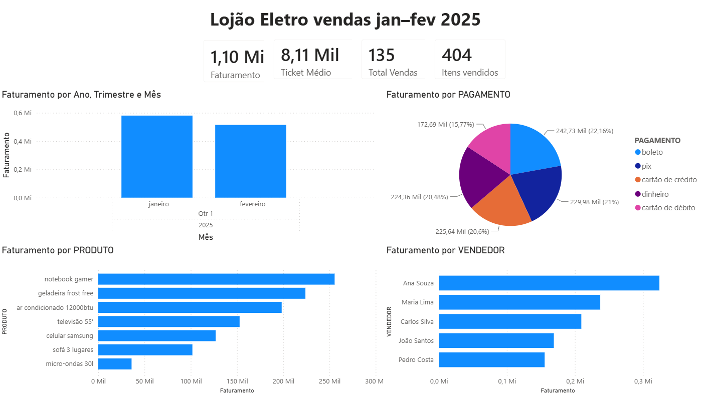

# Limpeza e Análise de Dados de Vendas — Lojão Eletro

Projeto de tratamento e análise de dados de vendas de janeiro e fevereiro de 2025 de uma loja fictícia de eletrodomésticos. O objetivo foi simular um cenário real de dado sujo, tratar as inconsistências com Python e apresentar os resultados em um dashboard no Power BI.



---

## O problema

As planilhas chegaram com os tipos de problema que aparecem em qualquer empresa que depende de preenchimento manual:

- Mesmo produto escrito de 5 formas diferentes ("Televisão 55'", "televisao 55", "TV 55 polegadas"...)
- Vendedor com nome duplicado por erro de digitação ("Carlos Silvaa", "Perdo Costa")
- Preços com "R$" no campo, vírgula no lugar de ponto, ou completamente em branco
- Datas em 4 formatos diferentes misturados no mesmo arquivo
- Cidades abreviadas, com erro ortográfico ou em caixa alta
- Notas fiscais em branco com venda registrada — possível problema fiscal

De 300 registros no total, **165 tinham algum tipo de problema**.

---

## Ferramentas

- Python 3 + Pandas
- Jupyter Notebook
- Power BI Desktop
- Excel (para inspeção visual dos dados)

---

## O que foi feito

### 1. Junção das planilhas

Os arquivos de janeiro e fevereiro foram lidos separadamente e concatenados em um único DataFrame com `pd.concat`.

### 2. Padronização de texto

Colunas como PRODUTO, VENDEDOR, CIDADE, CATEGORIA e PAGAMENTO foram padronizadas com `.str.lower()`, `.str.title()`, `.str.strip()` e `.str.replace()` para eliminar variações de caixa e espaços.

Erros de digitação foram corrigidos com dicionários de mapeamento:

```python
correcoes_vendedor = {
    'Carlos Silvaa': 'Carlos Silva',
    'Perdo Costa': 'Pedro Costa',
    'Ana Sousa': 'Ana Souza',
    ...
}
df_limpo['VENDEDOR'] = df_limpo['VENDEDOR'].replace(correcoes_vendedor)
```

Resultado: vendedores passaram de 25 variações para 5 nomes corretos. Cidades de 25 para 5.

### 3. Correção de tipos de dados

- **PRECO_UNIT**: estava como texto com "R$", vírgulas e espaços. Foi limpo com `.str.replace()` e convertido para float com `pd.to_numeric(errors='coerce')`
- **QUANTIDADE**: tinha valores como "3 un" — o " un" foi removido e o campo convertido para inteiro
- **DATA_VENDA**: 4 formatos diferentes foram normalizados com `dateutil.parser`. Datas fora do período jan/fev foram sinalizadas como suspeitas
- **NOTA_FISCAL**: estava como float64 e foi convertida para inteiro

### 4. Tratamento de nulos

Antes de remover qualquer dado, foi feita uma investigação do motivo dos nulos. Registros com nota fiscal preenchida mas preço em branco foram sinalizados para revisão — não removidos — porque a ausência do preço com nota presente sugere problema de sistema, não de preenchimento.

A QUANTIDADE nula foi preenchida com a média por produto, já que a distribuição era uniforme entre todos os produtos (média entre 2,6 e 3,8 para todos).

CPF em branco foi padronizado como "NÃO INFORMADO" — o cliente não é obrigado a informar.

### 5. Sinalização de problemas

Em vez de simplesmente deletar registros ruins, foi criada uma coluna `STATUS_GERAL` classificando cada registro:

- `OK` — pronto para análise
- `SEM PRECO` — preço ausente
- `SEM DATA` — data ausente
- `DATA SUSPEITA` — data fora do período esperado
- `SEM NOTA FISCAL` — possível problema fiscal

---

## Resultado

| Situação | Registros |
|---|---|
| OK — prontos para análise | 135 |
| Com algum problema | 165 |
| **Total** | **300** |

Dois arquivos foram exportados:
- `vendas_LIMPO_FINAL.xlsx` — dados limpos, usados no dashboard
- `vendas_PROBLEMAS_FINAL.xlsx` — registros sinalizados para revisão pelo time

---

## Dashboard no Power BI

O dashboard (`Portfólio.pbix`) usa os 135 registros válidos e traz:

- Cartões com faturamento, ticket médio, total de vendas e itens vendidos
- Faturamento por mês
- Faturamento por produto
- Faturamento por vendedor
- Faturamento por forma de pagamento

> O arquivo `.pbix` abre no Power BI Desktop. A imagem no topo deste README mostra o resultado.

---

## Análise dos dados limpos

Com os 135 registros válidos:

- **Faturamento total**: R$ 1,10 milhão
- **Ticket médio por venda**: R$ 8.114
- **Itens vendidos**: 404
- **Produto com maior faturamento**: Notebook Gamer (R$ 255 mil)
- **Melhor vendedora**: Ana Souza (R$ 324 mil — 38 vendas)
- **Menor faturamento por produto**: Micro-ondas 30L (produto mais barato do mix)
- **Janeiro faturou R$ 580 mil e fevereiro R$ 515 mil** — fevereiro foi 11,3% menor que janeiro

Um ponto de atenção identificado: João Santos concentrou 8 vendas de celular e zero de ar condicionado, enquanto Ana Souza vendeu 6 ares condicionados. Isso sugere uma especialização espontânea da equipe que pode ser formalizada pela gestão.

---

## Limitações e próximos passos

- A coluna `CATEGORIA` ainda tem valores inconsistentes (ex.: o mesmo produto aparece em "móveis" e "mobília"). Por isso o dashboard usa `PRODUTO` em vez de categoria. O próximo passo é mapear cada produto para uma única categoria no notebook.
- Os 165 registros sinalizados em `vendas_PROBLEMAS_FINAL.xlsx` dependem de revisão do time de origem antes de entrarem na análise.

---

## Conclusão

O problema principal não eram os dados em si — era o processo que os gerava. Com dois meses de dados, 55% dos registros tinham alguma inconsistência. Projetando para um ano, o volume de registros problemáticos seria proporcional.

O script de limpeza resolve isso: uma vez escrito, ele processa qualquer volume de dados no mesmo tempo. O que levaria semanas de correção manual passa a ser executado em segundos.

---

## Como rodar

```bash
# Instalar dependências
pip install pandas openpyxl python-dateutil jupyter

# Abrir o notebook
jupyter notebook limpeza_dados_vendas.ipynb
```

Os arquivos de entrada precisam estar na mesma pasta do notebook.

---

## Estrutura do repositório

```
├── vendas_janeiro_2025_SUJO.xlsx    # dados brutos de janeiro
├── vendas_fevereiro_2025_SUJO.xlsx  # dados brutos de fevereiro
├── limpeza_dados_vendas.ipynb       # notebook com todo o processo
├── vendas_LIMPO_FINAL.xlsx          # dados tratados
├── vendas_PROBLEMAS_FINAL.xlsx      # registros com problemas
├── Portfólio.pbix                   # dashboard no Power BI
├── dashboard.png                    # print do dashboard
└── README.md
```
